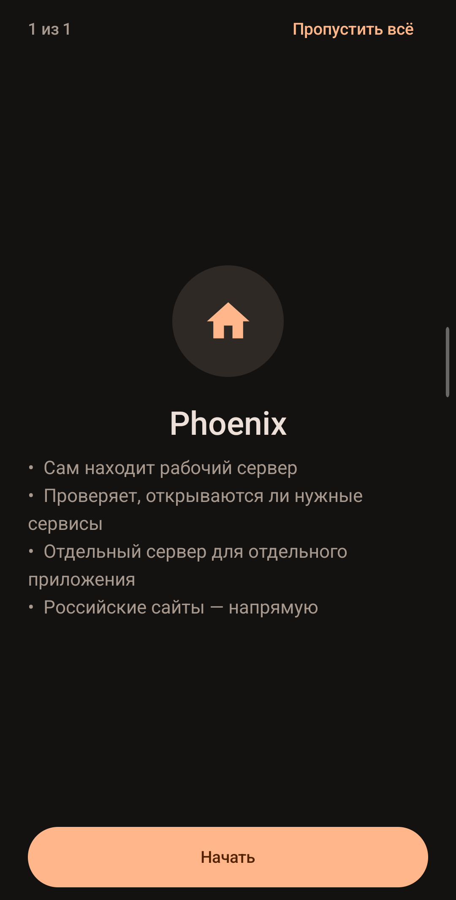
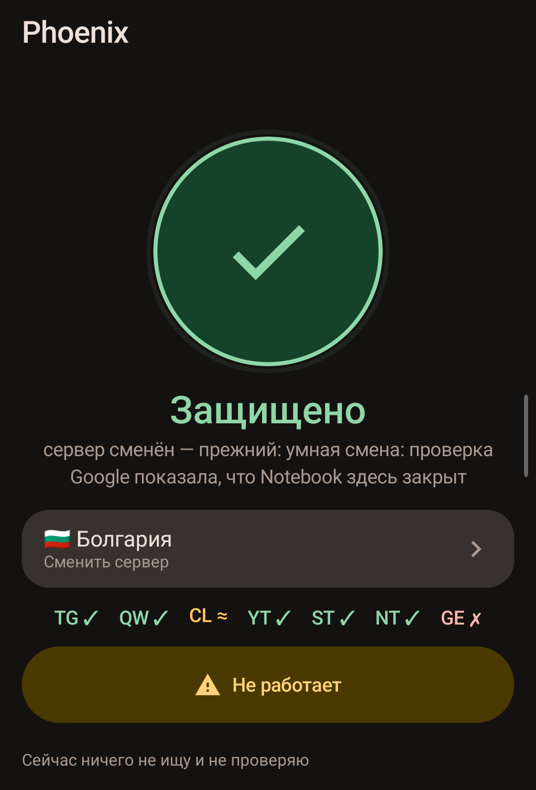
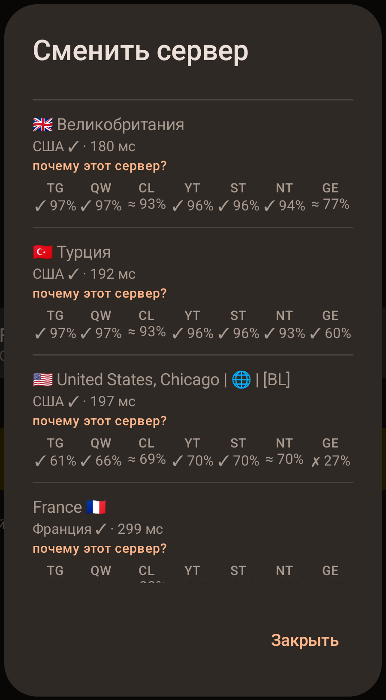
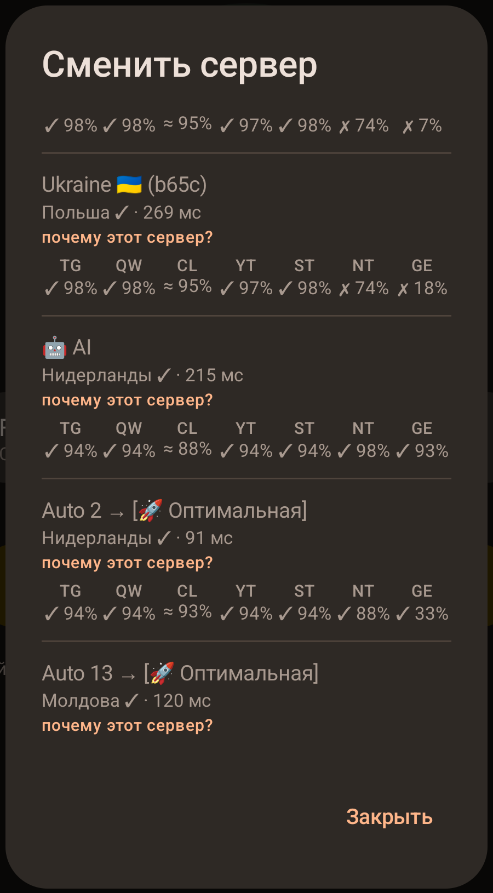
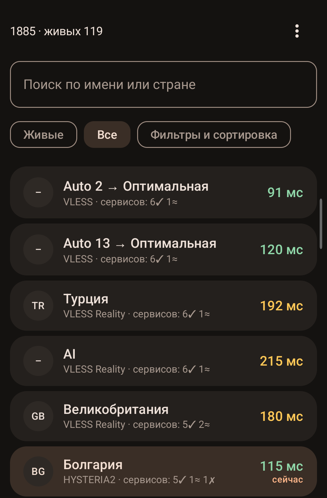
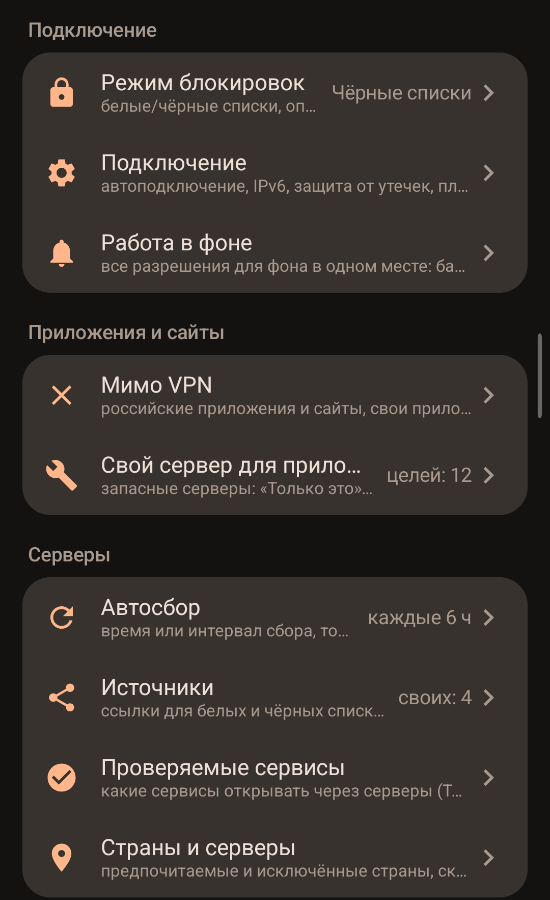
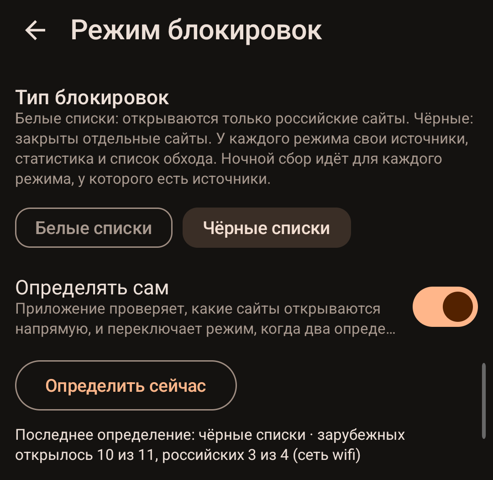
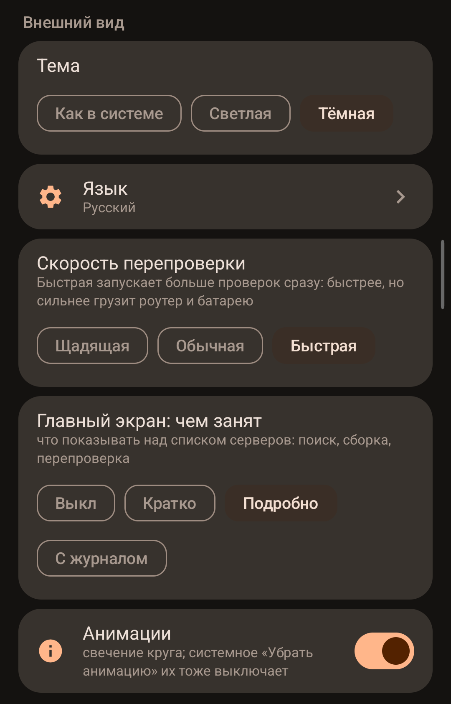

# Phoenix

Android-приложение: собирает публичные VPN-конфиги, проверяет их и подключает лучший через встроенное ядро Xray.
Рассчитано на сети, где блокировки двух видов: «белые списки» (открываются только разрешённые сайты) и «чёрные» (закрыто отдельное).
Интерфейс на 8 языках, лицензия MIT.

## Возможности
- **Сбор:** автосбор по расписанию (время или интервал) из списка источников, удаление повторов, GeoIP-метки, трекер стабильности, экспорт в V2RayNG и в файл. Аудит повторов источников — по кнопке и во время сбора.
- **Свой VPN-клиент:** vless / vmess / trojan / ss (reality, tls, ws, grpc, httpupgrade, xhttp), ядро Xray, режимы «Белые списки» и «Чёрные списки» с автоопределением по сети.
- **Умный выбор сервера:** проверка настоящим запросом, рейтинг по сети, автопереключение при сбое и низкой скорости, «последний рабочий» первым, закрепление выбранного вручную сервера на срок (до отключения, 1 час, 6 часов, сутки).
- **Сервер под приложение:** для выбранных приложений и сайтов (Telegram, Claude, Gemini, NotebookLM, Steam, DeepSeek, Qwen…) подбирается свой сервер: отдельным маршрутом только для приложения или переключением всего VPN. Приложение учится по каждой сети отдельно: если в этой сети оно и так работает напрямую, сервер под него не подбирается.
- **Обход VPN** для банков, Госуслуг и других приложений, которые лучше работают напрямую; режим «через VPN только выбранные приложения».
- **DNS в туннеле:** Cloudflare + Google, Google, Quad9, AdGuard; при смене 30 секунд на проверку, иначе откат.
- **Копии настроек:** экспорт и импорт файлом, автокопия раз в неделю во внутреннюю память (последние три).
- **Экономия:** лимит фонового мобильного трафика, только Wi-Fi для фона, учёт расхода по типам работы.
- **Журнал** с маскировкой ключей и токенов, выгрузка за 24 часа или целиком, диагностика «цели × сервисы».

## Скриншоты

<p>




</p>
<p>




</p>

1. **Первый запуск.** Что делает приложение: сам находит рабочий сервер, проверяет, открываются ли нужные сервисы, подбирает сервер под приложение, российские сайты пускает напрямую.
2. **Главная.** Состояние защиты, текущий сервер, значки сервисов (TG, QW, CL, YT, ST, NT, GE: ✓ открывается, ≈ частично, ✗ закрыт), кнопка «Не работает» и строка «чем занято приложение».
3. **Смена сервера.** Список серверов с проверкой каждого сервиса и страной выхода.
4. **Смена сервера, ниже по списку.** У каждого сервера видно, какие сервисы на нём открываются и с какой вероятностью («почему этот сервер?»).
5. **Серверы.** Все собранные серверы, фильтр «Живые», поиск, сводка по сервисам в каждой строке.
6. **Ещё: подключение.** Режим блокировок, подключение и работа в фоне, обход VPN для приложений и сайтов, свой сервер под приложение, автосбор, источники.
7. **Режим блокировок.** Белые или чёрные списки, автоопределение по тому, какие сайты открываются напрямую.
8. **Ещё: внешний вид.** Тема, язык, скорость перепроверки, вид блока «чем занят» на главном экране, анимации.

## Установка
Нужен Android 10 или новее. Скачайте APK из [Releases](../../releases) и установите поверх прежней версии. Если ключ подписи сменился, Android потребует переустановки: перед этим сделайте экспорт («Ещё → Копия») и после импортируйте. Ядро Xray уже внутри APK. При первом подключении Android спросит разрешение на VPN. На MIUI и похожих прошивках включите автозапуск и отключите ограничение батареи для Phoenix (подсказки в «Ещё → Фоновая работа»).

## Как собрать
Нужны Android Studio (Ladybug или новее) и JDK 17.

```bash
./gradlew testDebugUnitTest   # тесты логики на JVM
./gradlew assembleDebug       # APK: app/build/outputs/apk/debug/
```

Ядро Xray в репозиторий не входит: скачайте `libv2ray.aar` (релизы [AndroidLibXrayLite](https://github.com/2dust/AndroidLibXrayLite) или из [v2rayNG](https://github.com/2dust/v2rayNG)) и положите в `app/libs/`. Без файла приложение собирается и собирает конфиги, но подключиться не может.

Логика без Android (разбор ссылок, выбор сервера, режимы) проверяется ещё и отдельным набором в `tools/kt-harness/` (`bash tools/kt-harness/run.sh`).

## Языки интерфейса
Русский (исходный), English, Українська, Türkçe, Español, 中文, فارسی, العربية (последние два — справа налево). Язык берётся из системы (Android 13+: «Настройки → Языки приложений»). Журнал остаётся на русском.

Как добавить или исправить перевод: тексты в коде записаны как `tr("русский текст {}", аргумент)`. Переводы лежат в `tools/i18n/src/<язык>.*.tsv` (формат: номер строки из `app/src/main/assets/i18n/keys.txt`, табуляция, перевод; `{}` — подстановка). После правки: `python3 tools/i18n/build.py` (собирает словари в `assets/i18n/`) и `python3 tools/i18n/check.py` (проверяет, что у каждого `tr(...)` в коде есть ключ). Нет перевода — показывается русский.

## Документация
- [`CHANGELOG.md`](CHANGELOG.md) — история версий; заметки к релизам — `RELEASE_NOTES_*.md`.
- [`RELEASING.md`](RELEASING.md) — как выпускать: ключ подписи, сборка release.
- [`docs/HANDOFF.md`](docs/HANDOFF.md) — карта кода, принятые решения и открытые вопросы (для разработчика).
- [`docs/BASELINE.md`](docs/BASELINE.md) — накопленные данные: какие источники и сервисы работают.
- [`THIRD_PARTY.md`](THIRD_PARTY.md) — сторонние компоненты и благодарности авторам источников.
- Версия для Linux Mint (консольный демон на Python) — отдельный репозиторий.

## Устройство проекта
### Что где
- `Collector.kt` — весь конвейер (бывший save_vpn_configs.sh)
- `Enricher.kt` — GeoIP: имя → кэш → API (бывший geoip_enrich.sh)
- `Tracker.kt` — стабильность имён (бывший track_stable_configs.sh)
- `LinkParser.kt`, `Dedup.kt`, `NameGeo.kt`, `ServiceBlocks.kt`, `SourceState.kt` — чистая логика без Android, покрыта тестами (`app/src/test`)
- `Report.kt` — отчёт о прогоне (отдельный файл `report.txt` в папке дня, не смешан с конфигами): источники (проблемные сверху), счётчики дедупликации, страны, протоколы, трекер. Строится и при сбое. Вкладка «Отчёт» + кнопка «Сохранить отчёт» (Загрузки/Phoenix/phoenix-report.txt)
- `SourceAudit.kt` — аудит пересечений между источниками (бывшие dedup_check.sh / dedup_auto_apply.sh), `Blacklist` (чёрный список, файл `URL # причина`), `KeepList` (источники, которые вы вернули вручную)
- `UserSources.kt` — свои ссылки в пул источников (`my_sources.txt`)
- `AppSettings.kt` — время сбора, «только при зарядке», диагностика последнего запуска
- `Schedule.kt`, `Scheduler.kt` — запуск сбора тремя независимыми способами: точный будильник (AlarmManager) → срочная задача WorkManager; запасная периодическая задача; «догон» при старте процесса / после перезагрузки, если сегодняшнего файла нет. Дубли безопасны: если сегодняшний файл есть, запуск пропускается
- `Background.kt` — состояние разрешений и переходы в системные настройки (будильники, батарея, автозапуск MIUI)
- `Mode.kt` — режимы «Белые списки» / «Чёрные списки»: у каждого свои источники, чёрный список, статистика, файлы конфигов и список обхода VPN (белые лежат в корне данных — старые данные сохраняются, чёрные — в `mode_bl/`)
- `XrayConfig.kt` — ссылка (vless / vmess / trojan / ss; reality, tls, ws, grpc, httpupgrade, xhttp+extra, h2) → конфиг Xray (TUN-вход, proxy/direct/block). Покрыт тестами; JSON дополнительно проверен парсером
- `XrayCore.kt` — обёртка над `libv2ray.aar` через рефлексию (без файла приложение всё равно собирается)
- `PhoenixVpn.kt` — `PhoenixVpnService` (VpnService, TUN-дескриптор передаётся ядру напрямую, без tun2socks), состояние VPN
- `BypassApps.kt` — список обхода VPN: свои приложения + готовый российский набор (банки, Госуслуги, ВК, Яндекс, маркетплейсы, операторы…); само приложение всегда мимо VPN
- `ServiceCheck.kt` — проверка Telegram / Qwen / Claude / YouTube / Steam через каждый конфиг (временный экземпляр ядра), результаты по конфигам
- `VpnScreen.kt` — вкладка «VPN»
- `Targets.kt`, `TargetsWorker.kt` — цели (приложения и сайты) и подбор сервера под них: рейтинг кандидатов, фоновая проверка, свой маршрут по UID приложения или переключение всего VPN
- `DirectLearn.kt`, `DirectCatalog.kt`, `BypassApps.kt` (`BypassStore`) — что идёт мимо VPN в какой сети: обучение по сети, каталог приложений, список обхода по режимам
- `DnsProvider.kt` — провайдеры DNS и проба с откатом; `AutoBackup.kt`, `Backup.kt` — копии настроек и данных
- `PinPolicy.kt` — срок закрепления сервера, выбранного вручную

### Экраны
- **Главный** — состояние VPN и кнопки управления, «Собрать сейчас», сводка (сколько серверов и живых), копирование всех.
- **Серверы** (кнопка вверху) — все показатели каждого сервера (протокол, страна, дни, задержка, скорость, открытые сервисы, дата проверки), 9 видов сортировки с разворотом, фильтры (живые, проверенные, стабильные, протокол, страна), поиск, перепроверка, экспорт.
- **Настройки** — режим, приложения и сайты, обход VPN, подключение, автосбор, фоновая работа (все разрешения в одном месте), источники, экспорт и импорт, диагностика.

### Аудит источников
Каждый прогон сравнивает конфиги скачанных источников между собой (только свежие данные, без старого кэша).
Критерии как в Termux-версии: 100% включение; ≥90% включение при размере <50% от большего; дубликат ≥95% при близком размере.
Добавление в чёрный список автоматически — 1-го и 15-го числа, не больше 5 за раз; вручную — кнопка на вкладке «Источники».
Автоматически из чёрного списка ничего не удаляется (урок из Termux-версии). Вернули источник вручную — аудит его больше не предлагает.

### Данные
Внутри приложения (filesDir, для режима чёрных списков — подпапка `mode_bl/`): `my_sources.txt`, `sources_list_cache.txt` (запасной общий список), `audit_proposals.tsv`, `audit_keep.txt`, `sources_state.txt`, `blacklist.txt`, `geoip_cache.tsv`, `stable_configs.tsv`, `service_checks.tsv`, `bypass_apps.txt`, `auto_backup/` (автокопии), `download.log`, `sources_report.txt`, `ГГГГ-ММ-ДД/all-vpn-configs(-enriched).txt` (хранится 30 дней).
Кнопка «В файл» кладёт итоговый файл в Загрузки/Phoenix.

### Отличия от скриптов
- Hysteria2 и TUIC не поддерживаются (отбрасываются при сборе).
- vmess:// и ss:// в base64 разбираются (раньше их хост не находился).
- Источники скачиваются параллельно с ограничением нагрузки; проверка серверов идёт через общий лимит одновременных проб.
- GeoIP-API: ipwho.is по HTTPS, ограниченное число запросов за прогон.

### VPN: что важно знать
- Подключение: карточка сервера или кнопка на главной → системное окно «Разрешить VPN» (один раз) → значок ключа в статус-баре и кнопка «Отключить» в шторке.
- Поддерживаются vless / vmess / trojan / ss; транспорт kcp, плагины ss и нестандартные методы шифрования отклоняются с понятным сообщением.
- IPv6: режимы «Не трогать», «Блокировать», «В туннель» (настройки подключения).
- DNS в туннеле: запросы приложений обрабатывает ядро и спрашивает по HTTPS/TCP через сервер; провайдер выбирается в настройках, при смене есть 30 секунд на проверку и автоматический откат.
- Проверка сервисов использует ответ 200/204 или «мягкую» проверку страницы; у Claude и Qwen (защита от ботов) возможны ложные «✗», адреса проверки — в `ServiceCheck.kt`.
- Логика (конфиги, обход, проверки, режимы, расписание, подбор) проверена сотнями тестов на JVM; код VpnService и интерфейс — сборкой и проверкой на устройстве. Если что-то не работает, приложите журнал («Ещё → Журнал») — ключи и токены в нём замаскированы.

## Благодарности
Проект стоит на чужой работе: ядро [Xray-core](https://github.com/XTLS/Xray-core), его сборка для Android и [v2rayNG](https://github.com/2dust/v2rayNG) (2dust), туннель [hev-socks5-tunnel](https://github.com/heiher/hev-socks5-tunnel) (heiher), данные NRO для определения страны.
Отдельное спасибо авторам публичных списков конфигов, которые делают их бесплатно и без которых приложению нечего было бы проверять: полный перечень в [`THIRD_PARTY.md`](THIRD_PARTY.md).

## Ответственность
Phoenix не создаёт и не предоставляет VPN-серверов и не хранит чужие конфиги в репозитории: он скачивает публичные ссылки, проверяет их и подключается по желанию пользователя.
Серверы из публичных списков принадлежат неизвестным людям: через них может видеть ваш трафик третья сторона. Не передавайте через такие серверы пароли и платёжные данные без защищённого соединения (HTTPS).
Законы о средствах обхода блокировок отличаются в разных странах и меняются; соблюдение местных законов лежит на пользователе. Это не юридическая консультация.
Программа предоставляется «как есть», без гарантий (см. [`LICENSE`](LICENSE)).

## Лицензия
[MIT](LICENSE) © 2026 Hi_be
